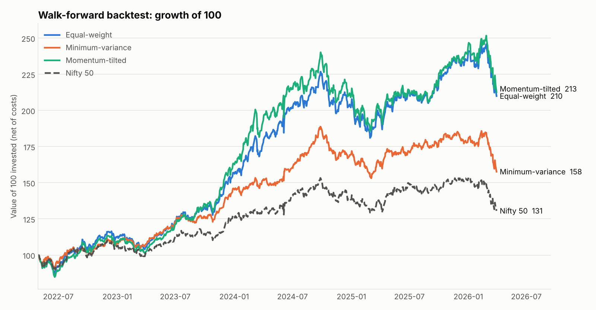
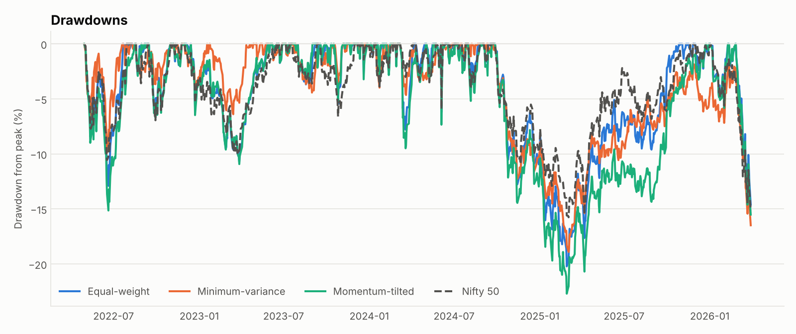
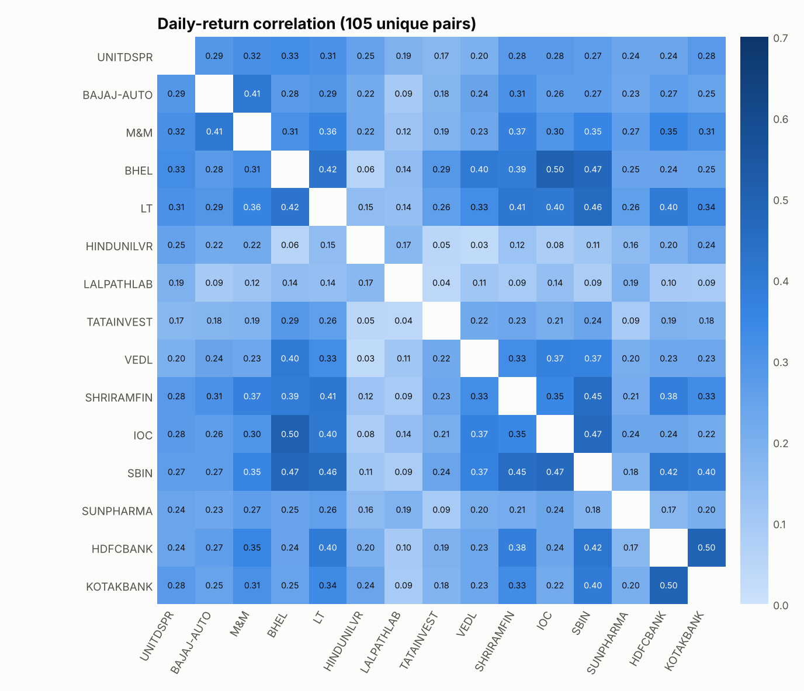
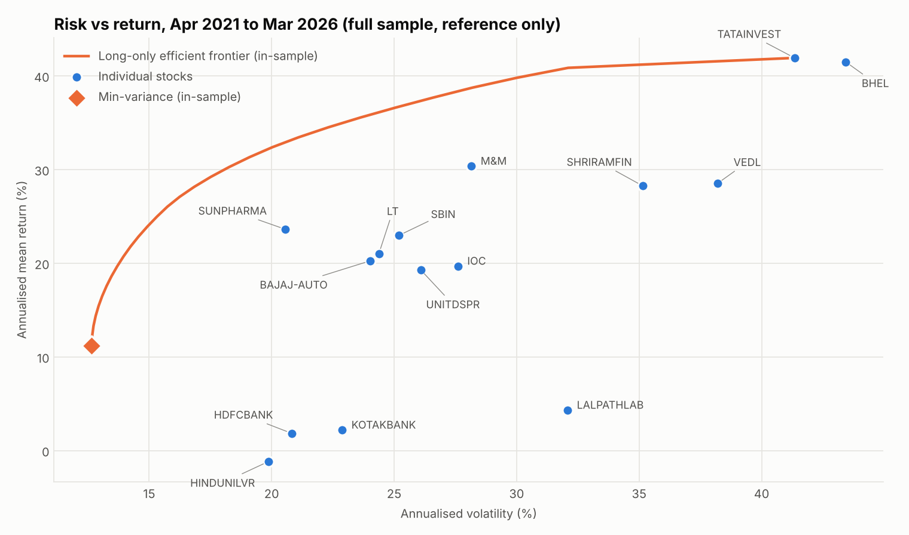
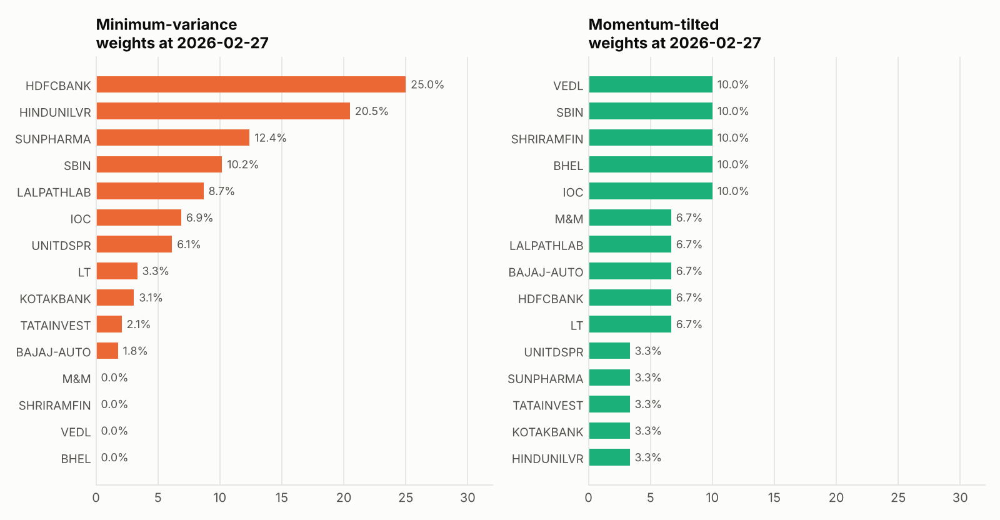

# Portfolio Construction & Risk-Return Analysis Engine

A SQL-first analytics pipeline that turns raw NSE price files for 15 stocks into returns, volatility and correlations, then backtests three long-only portfolios **walk-forward** (no look-ahead) against the Nifty 50.

**Live dashboard:** <https://tykonzzo.github.io/portfolio-risk-engine/> (enable GitHub Pages, see [Deploy](#deploy))



## Results

Out-of-sample period 2022-04-29 to 2026-03-30. The first 252 trading days are used only as history. Monthly rebalance, 10 bps one-way transaction cost, risk-free rate 6.0%.

| Strategy | Total return | CAGR | Volatility | Sharpe | Max drawdown | Turnover / yr |
|---|---|---|---|---|---|---|
| Equal-weight | 110.2% | 20.9% | 15.2% | 0.98 | -20.2% | 30% |
| Minimum-variance | 57.8% | 12.4% | 12.0% | 0.53 | -18.9% | 83% |
| Momentum-tilted | 112.9% | 21.3% | 16.4% | 0.93 | -22.7% | 98% |
| Nifty 50 | 30.6% | 7.1% | 13.0% | 0.08 | -15.8% | – |

* **Minimum-variance** cut volatility to 12.0% (from 15.2% for equal-weight) and has the shallowest drawdown among the three, but gave up return, so its Sharpe ratio is lower.
* **Momentum-tilted** earned the highest total return (112.9%) with the deepest drawdown (-22.7%) and the highest turnover.
* Average pairwise correlation is 0.25 (range 0.03 to 0.50) across all 105 stock pairs, so the basket diversifies well. The highest pair is BHEL / IOC (0.50).

> **Read this before quoting the numbers.** The 15 stocks are a hand-picked set, not the index, and were chosen with hindsight, so beating the Nifty 50 says more about stock selection than about portfolio method. The sample is one four-year, mostly rising market. The useful comparison is between the three strategies, which share the same stocks.

## How it works

```
data/raw/*.csv  ->  riskengine/ingest.py  ->  SQLite (sql/*.sql)  ->  riskengine/backtest.py  ->  outputs/ + docs/
 NSE price files     clean, de-duplicate      adjust, returns,        3 portfolios, metrics       CSV, JSON, PNG,
                                              volatility, drawdown,                               dashboards
                                              105 correlations
```

**SQL layer** (`sql/`, SQLite, window functions throughout)

| File | What it does |
|---|---|
| `01_schema.sql` | Tables: universe, raw prices, corporate actions |
| `02_adjust_prices.sql` | Back-adjusts closes for splits and bonuses (`EXP(SUM(LN(factor)))`, because SQLite has no PRODUCT) |
| `03_returns_panel.sql` | Common trading calendar, daily simple and log returns with `LAG()`, gap flags |
| `04_risk_stats.sql` | 63-day rolling volatility, running-peak drawdown, per-stock summary, 105 pairwise correlations built from running sums |

**Strategies** (`riskengine/backtest.py`). All long-only and fully invested, rebalanced at each month-end close using only data up to that close.

| Strategy | Rule |
|---|---|
| Equal-weight | 1/15 each |
| Minimum-variance | Minimise `w'Σw` on the trailing 252 days (SciPy SLSQP), each stock capped at 25% |
| Momentum-tilted | Equal weights x 1.5 / 1.0 / 0.5 for the top / middle / bottom third by 12-month return, skipping the latest month |

Sharpe ratio = (CAGR minus risk-free) / annualised volatility of daily returns. Weights drift with prices between rebalances, and each rebalance pays the transaction cost on traded notional.



## Data quality: what was found and fixed

The raw files had problems that would have silently corrupted any risk number. Each is handled in code and covered by a test.

1. **Unadjusted splits and bonuses.** Six stocks show one-day "crashes" of 32% to 90% that are really corporate actions (`data/corporate_actions.csv`: IOC, Shriram Finance, HDFC Bank, Tata Investment, Dr. Lal PathLabs, Kotak). Prices are back-adjusted, and the residual move on each ex-date is under 6%. The factors were inferred from the clean price ratios, so confirm them against NSE's corporate-actions page.
2. **A hole in Tata Investment's history.** An export filtered to NSE series `EQ` silently omits the 62 days from 29 Feb to 31 May 2024 when the stock traded in the trade-for-trade `BE` series. They were recovered from NSE's official daily bhavcopy (`tools/build_bhavcopy_supplement.py`). Validation: all 62 recovered returns sit inside the ±5% band NSE enforces on BE stocks, and across 780 rows for the other 14 stocks the bhavcopy closes match the supplied files exactly. Two days (2 Mar and 26 Mar 2024) are absent from the bhavcopy mirror, so their closes are taken from the next session's previous-close field, which is how NSE records them. Those two rows have no open, high, low or volume.
3. **File-format quirks.** Indian digit grouping (`1,02,40,982`), two date formats, one stock delivered as a close-only five-year file that overlaps its yearly files (1,240 duplicate days removed), and 2 block-deal (`BL`) rows that disagree with the regular session.

Result: 76 files, 19,827 rows read, **18,585 clean rows**, all 15 stocks on all 1,239 trading days (2021-04-01 to 2026-03-30).

**Benchmark.** `data/benchmark/NIFTY50_daily.csv` is rebuilt from 1-minute Nifty 50 bars (`tools/build_nifty_daily.py`). NSE's official close averages the last 30 minutes, so the file uses the mean of OHLC/4 over the last 30 bars. This reproduces six published closes to within 1.4 points (0.01%) and is checked in the tests. The evening Diwali Muhurat session of 24 Oct 2022 has no index bars, so the prior close is carried forward for that one day.





## Verification

`python -m pytest -q` runs 20 tests, including:

* SQL volatility, rolling volatility and all 105 correlations match independent pandas calculations to 1e-9.
* **No look-ahead:** scrambling every return after a date leaves all earlier weights unchanged. The test was mutation-checked by injecting a deliberate leak and confirming it fails.
* The equal-weight NAV matches a hand-rolled loop to 12 significant figures.
* The minimum-variance solution satisfies its constraints and beats 500 random feasible portfolios.
* Corporate-action adjustment removes every artificial crash, and recovered BE-series returns stay inside ±5%.
* The engine still handles a data gap if a future export has one (tested by deleting the supplement).

## Run it

```bash
pip install -r requirements.txt
python run_pipeline.py                 # about 3 seconds: database, backtest, CSVs, charts, docs/index.html
python -m pytest -q                    # 20 tests
streamlit run app/streamlit_app.py     # interactive dashboard
python run_pipeline.py --rf 0.065 --cost-bps 20 --max-weight 0.20 --lookback 126   # change assumptions
```

Outputs land in `outputs/`: `metrics.csv`, `nav.csv`, `drawdown.csv`, `weights_*.csv`, `correlation_matrix.csv`, `correlation_pairs.csv`, `stock_stats.csv`, `efficient_frontier.csv`, `data_quality.json`, `results.json`.



## Deploy

* **GitHub Pages (static, no server).** Repository Settings, Pages, deploy from branch `main`, folder `/docs`. `docs/index.html` is a self-contained interactive dashboard.
* **Streamlit Community Cloud.** New app, select this repo, main file `app/streamlit_app.py`.

## Limitations

* Price returns only. Dividends, taxes and market impact are excluded. The Nifty 50 series is also a price index, so the comparison is like for like.
* The efficient frontier and the in-sample minimum-variance point use the full sample and are shown for reference only. The backtested strategies use trailing data.
* Costs are a flat 10 bps. The 25% cap and the 1.5x / 0.5x momentum multipliers are design choices, not optimised.
* Results from one market regime say little about performance in a different one.

## Repository layout

```
run_pipeline.py            end-to-end run
riskengine/                ingest, SQL runner, backtest, charts, dashboard builder
sql/                       the four SQL files
tools/                     scripts that built the supplement and benchmark files, and this README
data/                      raw NSE files, universe, corporate actions, benchmark
app/streamlit_app.py       interactive dashboard
docs/                      static dashboard (GitHub Pages) and chart images
tests/                     20 tests
```

## Data sources

* Historical daily prices: NSE-format price files supplied by the author.
* Recovered Tata Investment days: NSE `sec_bhavdata_full` daily files, via the public mirror [tilak999/NSE-Data-bank](https://github.com/tilak999/NSE-Data-bank).
* Nifty 50 1-minute bars: [technovusin/nifty50-historical-data](https://github.com/technovusin/nifty50-historical-data) (MIT).

Raw NSE data is included for reproducibility. Check NSE's terms before redistributing it commercially. Code is MIT-licensed.
